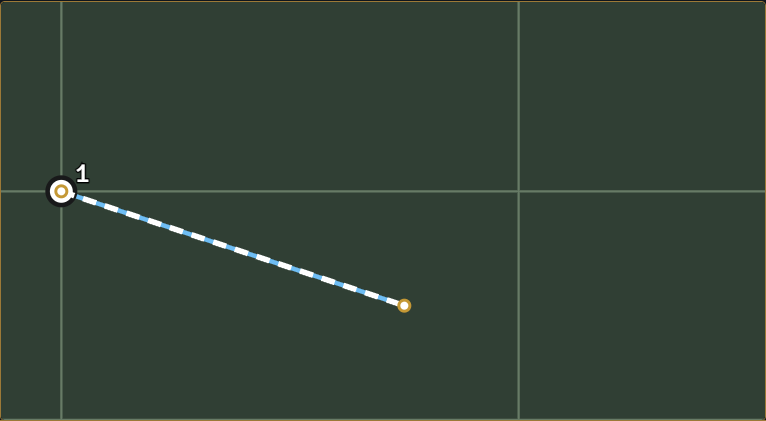
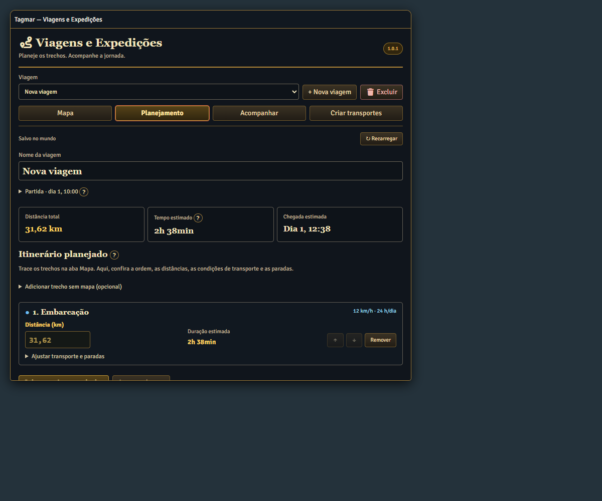
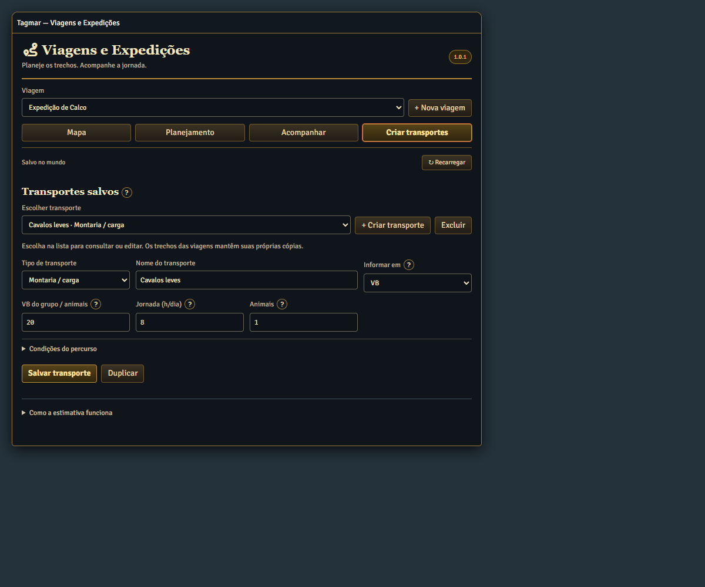
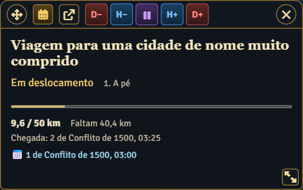

# Tagmar — Viagens e Expedições

### Versão 1.0.3

O painel compacto volta a abrir na mesma viagem ao entrar no mundo se estava aberto quando você saiu. Use o **X** do painel para mantê-lo fechado. A restauração usa a posição e o tamanho salvos.

### Foundry VTT 14.370 — 05/11/2026

Compatibilidade verificada com Foundry VTT 14.370. O campo Nome da viagem fica no topo da aba Mapa. Salvar o nome preserva a rota, o progresso e o vínculo com o calendário.


**Versão estável 1.0.3 · Foundry VTT 14.370 · Tagmar XXX e Tagmar 3ER Oficial**

Planeje caminhos no mapa, combine transportes e acompanhe a viagem pela passagem do tempo. Uso exclusivo do mestre, com médias ajustáveis e integração opcional com o Grande Calendário de Tagmar.

## Instalar e ativar

Em **Configuração → Módulos adicionais → Instalar módulo**, cole o manifesto:

```text
https://raw.githubusercontent.com/piratabarba-blip/modulos_foundry/v14/tagmar-viagens/module.json
```

Entre no mundo, ative **Tagmar — Viagens e Expedições** e clique no ícone de **rota** na barra esquerda. Também há **Configurações do Jogo → Viagens e Expedições → Abrir planejador**. O [Grande Calendário](https://raw.githubusercontent.com/piratabarba-blip/modulos_foundry/v14/tagmar-calendario/module.json) é recomendado para sincronizar horas e dias; sem ele, o avanço é manual.

A instalação começa **sem viagens, caminhos, mapas de campanha ou transportes personalizados**. Inclui somente quatro modelos editáveis: **A pé**, **Montaria / carga**, **Carroça** e **Embarcação**. Mapas e mídias são escolhidos no mundo de cada mestre. As imagens deste guia usam exemplos demonstrativos, que não são instalados como viagens.

## 1. Mapa: montar o caminho

1. Clique em **Nova viagem**. A aba **Mapa** abre primeiro. Preencha **Nome da viagem** e clique em **Salvar nome**.
2. Use **Adicionar mapa**, escolha uma cena e clique em **Usar imagem de fundo e escala**. A cena original não é aberta nem alterada. Se preferir um arquivo, abra **Usar arquivo de imagem (opcional)**.
3. A escala da cena é convertida para quilômetros quando possível. Se faltar escala válida, use **Calibrar escala**, marque dois pontos e informe a distância conhecida entre eles. Cenas hexagonais ou com escala distorcida exigem calibração manual.
4. Escolha um transporte e clique em **Traçar trecho**. Clique no mapa seguindo estradas, rios ou litoral; **Salvar trecho** calcula a distância. Um novo trecho pode usar outro transporte e continua do ponto anterior.
5. Clique em uma linha ou em **Editar caminho** para ajustar seus pontos. **Retirar último ponto** desfaz o último ponto em edição; **Cancelar** descarta somente o traçado ainda não salvo.

Arraste com o **botão direito** para mover o mapa. A **rodinha** amplia ou reduz no ponto do cursor; os botões **+ / −** também estão disponíveis. Posição e zoom são lembrados ao trocar ferramentas, abas e reabrir. Os pinos são pequenos, com uma área de clique maior para facilitar a edição.



**Mapas salvos** guarda imagens e escalas no mundo. Novas viagens reaproveitam o último escolhido. Para salvar outra escala da mesma imagem, abra **Adicionar mapa**, dê outro nome e use **Salvar como novo mapa**. Cada viagem mantém sua própria cópia: recalibrar ou remover uma entrada da biblioteca não altera os outros roteiros. **Remover da lista** não apaga arquivos ou cenas.

Depois de traçar caminhos, a troca da imagem é bloqueada para proteger as coordenadas. Para outro mapa, crie outra viagem ou remova os traçados antes de trocar. Depois de iniciar o percurso, duplique a viagem para planejar alterações; a cópia reinicia o progresso e mantém o desenho.

## 2. Planejamento: conferir e ajustar

Confira distância total, tempo estimado e chegada. Cada trecho mostra sua **Duração estimada**, incluindo jornada, descansos e espera antes de partir. Passe o mouse para ver a discriminação. Em **Ajustar transporte e paradas**, altere as condições e use **Salvar roteiro e recalcular**.



Distâncias desenhadas aparecem com duas casas decimais; as coordenadas e a precisão dos cálculos são preservadas. Para planejar sem mapa, abra **Adicionar trecho sem mapa (opcional)** e informe os quilômetros. Os botões **?** explicam os campos; clique ou pressione Enter para abrir a ajuda.

**Excluir**, ao lado de **Nova viagem**, remove apenas a viagem escolhida após confirmação. A exclusão não tem desfazer e preserva mapas, transportes e outros roteiros. **Duplicar sem progresso**, em Mais opções, cria uma cópia independente.

## 3. Criar transportes

Uma única lista reúne os quatro modelos iniciais e todos os transportes salvos. Escolher um mostra seus atributos para consulta ou edição.



**Criar transporte** prepara uma ficha sem gravar: escolha o tipo, informe nome, VB ou média em km/h, jornada e condições. **Salvar transporte** registra na lista; **Cancelar** descarta a criação. **Duplicar** também prepara uma cópia que só é registrada ao salvar. **Excluir** remove o transporte escolhido após confirmação. Viagens existentes mantêm suas próprias cópias dos atributos.

- **VB:** o mestre informa o valor do grupo ou dos animais. Conversão: `VB × 0,24 km/h`.
- **Média em km/h:** informe diretamente uma velocidade sustentável, como 8 km/h para uma embarcação.
- **Jornada:** 8 horas por dia implica 16 de descanso; 24 horas indica movimento contínuo com revezamento. Cada trecho começa seu ciclo e não há descanso extra depois da chegada.
- **Ritmo, caminho, carga e cansaço:** multiplicadores editáveis. Valor 1 é neutro; 0 impede deslocamento. São sugestões de ambientação, não regras oficiais de Tagmar.
- **Porte e animais:** anotações do transporte. Não multiplicam a velocidade automaticamente.

Não há leitura automática de inventários ou VB dos atores. O mestre pode escolher a menor VB ou uma média. Alterações de velocidade após iniciar afetam somente o percurso restante; distância e jornada de um trecho iniciado permanecem protegidas.

## 4. Acompanhar e sincronizar com o calendário

Em **Acompanhar**, confira o trecho atual, deslocamento/descanso/espera, quilômetros e chegada. **Vincular esta viagem ao calendário** sincroniza somente uma viagem por mundo. Abrir o painel compacto também vincula a escolhida quando o calendário está ativo.

- **H− / H+ e D− / D+:** com vínculo, mudam o relógio do mundo e a viagem; mudanças feitas no calendário também atualizam o percurso. Um dia equivale a 24 horas.
- **Parar / Retomar:** suspende somente o deslocamento. O calendário pode continuar passando.
- **Desvincular:** volta ao avanço manual e independente.
- **Desfazer:** disponível no avanço independente; com vínculo, use as setas para retroceder horas ou dias.



No painel compacto, a **cruz** move a janela e a **alça diagonal** ajusta o tamanho. Posição e tamanho ficam salvos neste navegador. Os atalhos de calendário e planejador ficam no topo, junto dos controles de tempo. Fechar no **X** não exclui nem pausa a viagem. Quando permanece aberto, reaparece na entrada seguinte nesse navegador.

O vínculo preserva o progresso anterior. Retornar no tempo recompõe os períodos registrados de movimento, descanso e pausa; antes do primeiro vínculo, o progresso antigo é mantido. Se a chegada ocorrer durante um avanço maior, o calendário continua pelo intervalo completo e o horário da chegada é preservado.

## Dados, atualização e imagens

Viagens, mapas e transportes pertencem à configuração do mundo `tagmar-viagens.state` (`schema: 1`), não aos arquivos do módulo. Atualizar o módulo preserva esses registros. Não são alterados atores, itens, cenas, sistemas ou compêndios. Mantenha mídias pessoais no mundo ou em uma pasta própria de Data e faça backup do mundo.

Para uma **prévia local sem manifesto de atualização**, cadastre uma vez o endereço acima como `manifest` em `Data/modules/tagmar-viagens/module.json`, com o Foundry fechado, e depois use **Atualizar**. A versão 1.0.1 é reconhecida pelo comparador do Foundry como mais nova que as prévias 1.0.0-rc. A operação deve preservar o mesmo ID do módulo e os dados do mundo; não exclua o mundo para atualizar.

Uma imagem com **404** indica caminho inexistente ou arquivo removido/renomeado no seu mundo. Confirme a extensão, como `.webp` ou `.jpg`, na cena e no seletor de arquivos. A biblioteca guarda a referência original; não converte imagens nem inclui arquivos da campanha no módulo.

Limites: 50 viagens, 500 transportes, 100 mapas salvos e 100 trechos por viagem. Cada viagem usa um mapa. Vento, correntes, capacidade de carga e cansaço automáticos ficam para versões futuras. O módulo não possui relógio automático próprio.

## Validação e créditos

A versão foi validada pelo usuário em mesa no Foundry 14.369, além de 53 testes de modelo e testes de navegador com código/templates reais e relógio/armazenamento simulados. As verificações automatizadas com CSS e posicionamento do núcleo usam recursos locais do Foundry 14.367; não constituem certificação dos outros módulos instalados.

Desenvolvimento: PirataBarba, com assistência de IA na programação e testes. Código sob [GPL-3.0-or-later](LICENSE.md). [Tagmar](https://tagmar.com.br/) é um projeto de RPG brasileiro mantido por sua comunidade. Este módulo não inclui livros, compêndios ou mapas de campanha. [Licenciamento do Tagmar](https://tagmar.com.br/Licenciamento.aspx).
